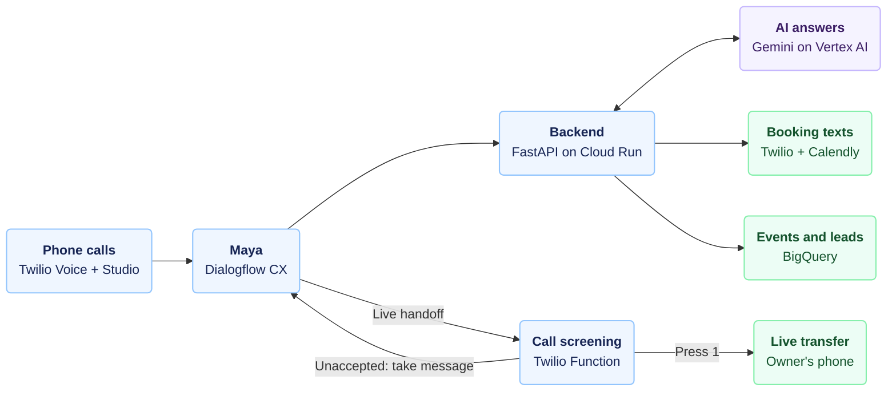

# Maya · Dialogflow CX Virtual Agent

A business phone solution for **a working technology firm**, designed and built by Edward Thornton with Dialogflow CX, Gemini on Vertex AI, FastAPI on Cloud Run, and BigQuery. Maya captures caller details, answers service questions, and guides callers toward a consultation, an accepted live transfer, or a message for follow-up.

The business purpose is to turn an incoming inquiry into an actionable next step, preserve context for the person responding, and make follow-up measurable. BigQuery is now part of the project: the dataset, lead and event tables, reporting views, and backend ingestion are deployed. Power BI is the next milestone. The first live database write remains to be verified.

**Checkpoint: November 1, 2026.** The owner confirmed the press-1 transfer now works after correcting the destination number. The published Studio flow routes unaccepted transfers back to Maya for message capture; decline/no-answer checks and end-to-end message delivery remain to be verified.

BigQuery ingestion is deployed in Cloud Run revision `cx-backend-00006-ml5`, serving 100% of traffic. The dataset is `csd-dialogflow-cx-2026.maya_analytics` in `us-central1`.

## Phone flow

<a href="docs/images/cx-phone.jpg?v=20261101-redacted"></a>

*Published Studio flow: incoming call → Maya → screened transfer. The owner answers and presses 1 before connection; the Return path leads to Maya’s message-taking session. The older transfer/status widgets remain visible but are outside the active handoff route. The owner’s phone number is masked as `xxx-xxxx`. Click to enlarge.*

## Current status

| Area | Status |
| --- | --- |
| Phone intake | Branded greeting, caller name, and callback confirmation exercised on calls. |
| Conversation | Contextual discovery, corrections, and service answers implemented and evaluated. |
| Booking and alerts | Booking-link and owner-alert texts received. Customers schedule in Calendly. |
| Live transfer | Owner confirmed the press-1 transfer works after correcting the destination number. |
| Missed-call messages | Studio Return is connected to Maya; unanswered return was previously observed. Decline/no-answer screening checks and full message delivery remain unverified. |
| Analytics | BigQuery event and lead tables, reporting views, and Cloud Run ingestion deployed. Dataset access granted to the backend identity; 74 offline tests passed. The first live write remains unverified. |

## Architecture



Twilio connects calls to Maya. The backend supports AI answers, booking texts, and structured event and lead writes to BigQuery. Studio invokes a protected Twilio Function for press-1 screening and resumes the message-taking widget when the function returns an unaccepted transfer.

| Component | Responsibility |
| --- | --- |
| Twilio Voice + Studio + Functions | Connect calls to Dialogflow, screen live handoffs with press-1 acceptance, and return unaccepted transfers to Maya. |
| Dialogflow CX | Manage intents, contact intake, conversation state, and action routes. |
| FastAPI on Cloud Run | Authenticate fulfillment requests and coordinate discovery and customer actions. |
| Gemini on Vertex AI | Use recent conversation context for extraction, answers, corrections, and summaries. |
| Twilio Messaging + Calendly | Send permission-based booking links and owner alerts; customers choose a meeting time externally. |
| BigQuery | Store structured backend events and lead snapshots; provide deduplicated and aggregate reporting views. |

Security, design decisions, and failure handling are covered in the [architecture notes](docs/architecture.md).

## Security and secret management

The documented Cloud Run deployment stores the **Twilio Auth Token in Google Cloud Secret Manager**, under `twilio-auth-token`, and references it through the secret-backed `TWILIO_AUTH_TOKEN` environment variable. [`backend/notify.py`](backend/notify.py) reads that value at runtime to authenticate outgoing Twilio messaging requests; the token value is not hard-coded in the source. The setup grants the backend service identity Secret Accessor on that secret.

- Dialogflow’s exported webhook configuration uses service-agent **ID tokens** to invoke Cloud Run. Backend authentication relies on Cloud Run IAM, rather than an application-level shared password.
- The `/maya-transfer` Function is configured as **Protected**, using Twilio’s request-signature validation before the handler runs.
- Local `.env` files and common credential/key files are excluded from source control and build uploads by the ignore files. Those guards do not remove previously committed content.
- An owner-requested review of both branches and all 29 reachable commits found **no confirmed authentication credentials**. One repeated Dialogflow configuration UUID was flagged by the scanner and remains a metadata-classification review item. Anonymous Cloud Run health and unsigned, non-dialing Function checks each returned HTTP 403.

These observations are bounded evidence, not a guarantee of complete security. Current secret versions, rotation, and exact live IAM grants were not inspected. The [security review and verification notes](docs/security.md) explain the scope, findings, caller-data considerations, and remaining checks. Email secret setup is documented separately; successful email delivery is still unverified.

## Development timeline

| Date | Milestone |
| --- | --- |
| Oct 25, 2026 | Built consultation intake, required form capture, a welcome response, and the external booking-link ending. |
| Oct 26 | Added FastAPI, structured Gemini discovery, Docker packaging, and local service checks. |
| Oct 27 | Deployed authenticated Cloud Run fulfillment and connected the Dialogflow agent to Twilio voice. |
| Oct 28 | Added caller contact intake, shorter prompts, booking texts, lead alerts, and message/handoff handlers. |
| Oct 29 | Added conversation history, correction handling, reviewed policy answers, and model evaluation. Approved Maya’s new greeting. |
| Oct 30 | Confirmed a working cell transfer and added the transfer-status split in Studio. |
| Oct 31–Nov 1 | Added protected call screening, published the Return route to Maya, corrected the owner destination, and confirmed the press-1 transfer works. |
| Nov 1 | Created BigQuery event/lead tables and reporting views, granted dataset access, and deployed backend ingestion to Cloud Run. |

## Validation

- **74 offline tests** passed, including analytics row construction, identity, consent, retry IDs, outcome semantics, and failure isolation. Model responses, notifications, and database writes are mocked.
- **13 real Vertex requests** completed with zero errors and **1.20–5.32 seconds per generation** in one evaluation. Follow-up fixes constrained unsupported policy answers; these timings do not measure full calls.
- **Phone checks:** owner-confirmed press-1 transfer, previously observed unanswered return to Maya, and received booking/handoff texts. The new screening route still needs decline/no-answer checks and a complete message-delivery test.

Run the offline checks from the repository root:

```bash
python -m pip install -r requirements.txt -r requirements-dev.txt
python -m pytest -q
```

The real-model evaluator is `scripts/evaluate_conversation.py`. Deployment context and operational instructions are in the [current checkpoint](docs/project-notes.md).

## Repository guide

- [`backend/`](backend/) — FastAPI fulfillment, conversational discovery, contact handling, and notifications.
- [`dialogflow/agent/`](dialogflow/agent/) — versioned Dialogflow configuration.
- [`scripts/`](scripts/) and [`tests/`](tests/) — build/apply helpers, model evaluation, and offline checks.
- [`twilio/functions/maya-transfer.js`](twilio/functions/maya-transfer.js) — deployed screening function source; [setup and validation](docs/project-notes.md#screened-transfer-setup).
- [BigQuery analytics setup and deployment](docs/analytics.md) — tables, views, call identity, live verification, and ingestion limits.
- [Portfolio page source](docs/dialogflow-cx.html) · [Current checkpoint](docs/project-notes.md) · [Detailed build history](docs/build-history.md) · [Security review](docs/security.md).

## Next milestone

**Power BI:** connect BigQuery reporting views to a dashboard for observed call activity, service demand, and follow-up needs.

**Purpose:** connect real caller interactions to measurable business outcomes and better follow-up.

Message transcripts currently use Cloud Logging.


