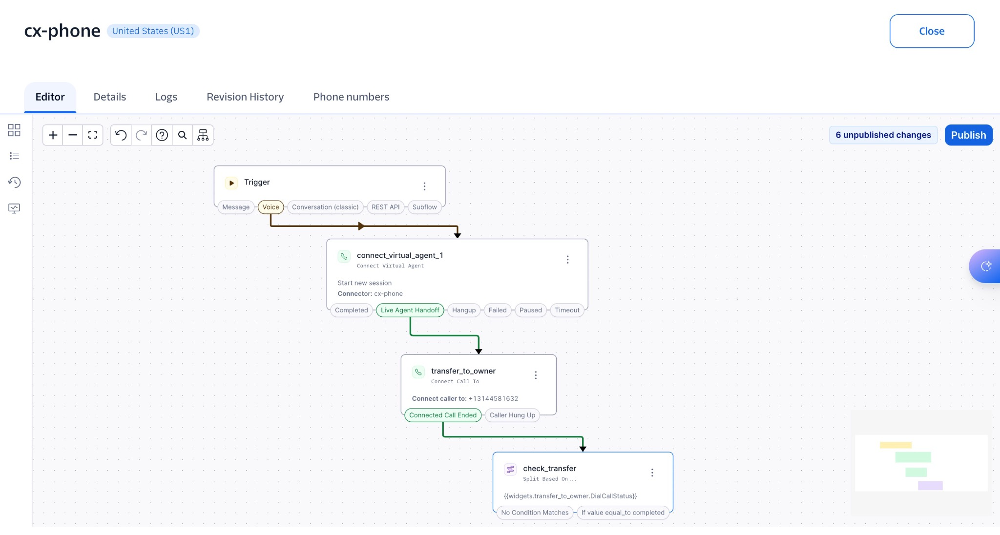
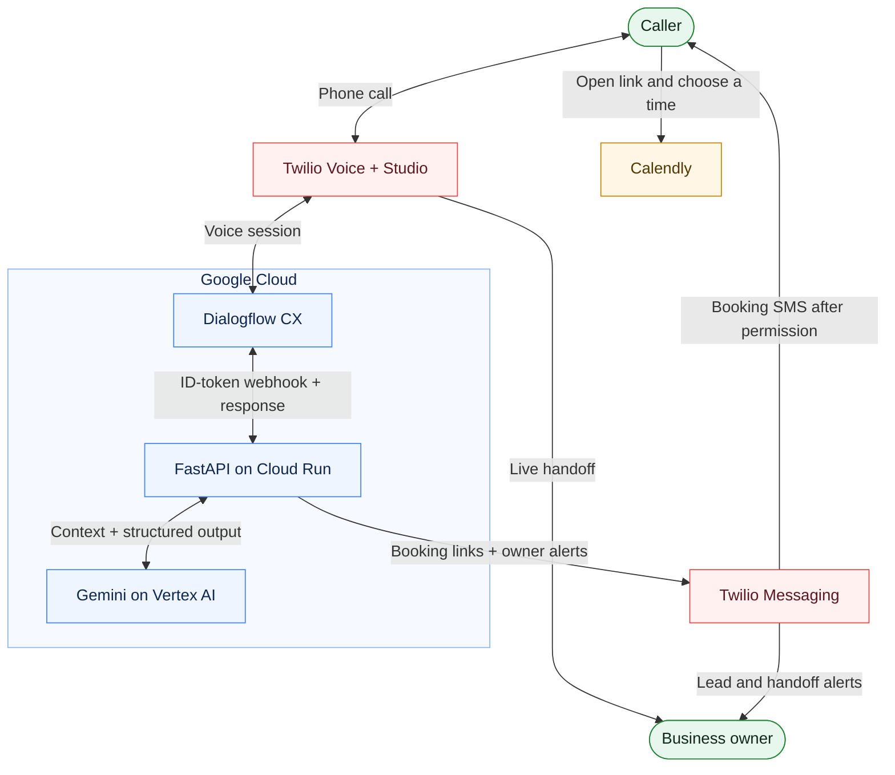

# Maya · Dialogflow CX Virtual Agent

A phone assistant for **Cloud Systems Direct**, built by Edward Thornton with Dialogflow CX, Gemini on Vertex AI, and FastAPI on Cloud Run. Maya captures caller details, answers service questions, and guides customers toward booking, a live transfer, or a message.

**Checkpoint: October 30, 2026.** A live transfer to the owner’s cell has been test-called successfully. Missed-call message routing is the next integration to finish.

## Phone flow

<a href="docs/images/cx-phone.jpg"></a>

*Studio checkpoint: incoming call → Maya → live handoff → transfer-status check. Draft changes are visible; the missed-call branch is not connected yet. Click to enlarge.*

## Current status

| Area | Status |
| --- | --- |
| Phone intake | Branded greeting, caller name, and callback confirmation exercised on calls. |
| Conversation | Contextual discovery, corrections, and service answers implemented and evaluated. |
| Booking and alerts | Booking-link and owner-alert texts received. Customers schedule in Calendly. |
| Live transfer | Owner confirmed a successful transfer to their cell. |
| Missed-call messages | Backend built; Studio return path and delivery test unfinished. |

## Architecture



Studio controls the call and live transfer. Dialogflow manages conversation state; Cloud Run coordinates model requests and external actions. The customer opens the SMS link to schedule in Calendly. The missed-call return path remains in progress.

| Component | Responsibility |
| --- | --- |
| Twilio Voice + Studio | Connect calls to Dialogflow and route live handoffs. |
| Dialogflow CX | Manage intents, contact intake, conversation state, and action routes. |
| FastAPI on Cloud Run | Authenticate fulfillment requests and coordinate discovery and customer actions. |
| Gemini on Vertex AI | Use recent conversation context for extraction, answers, corrections, and summaries. |
| Twilio Messaging + Calendly | Send permission-based booking links and owner alerts; customers choose a meeting time externally. |

The backend uses service-agent ID-token authentication and a dedicated runtime service account. Twilio credentials are referenced through Secret Manager. One Cloud Run instance is kept warm to reduce startup pauses.

See the [architecture decisions, security boundaries, and failure handling](docs/architecture.md).

## Development timeline

| Date | Milestone |
| --- | --- |
| Oct 25, 2026 | Built consultation intake, required form capture, a welcome response, and the external booking-link ending. |
| Oct 26 | Added FastAPI, structured Gemini discovery, Docker packaging, and local service checks. |
| Oct 27 | Deployed authenticated Cloud Run fulfillment and connected the Dialogflow agent to Twilio voice. |
| Oct 28 | Added caller contact intake, shorter prompts, booking texts, lead alerts, and message/handoff handlers. |
| Oct 29 | Added conversation history, correction handling, reviewed policy answers, and model evaluation. Approved Maya’s new greeting. |
| Oct 30 | Confirmed a working cell transfer and added the transfer-status split in Studio. Missed-call message wiring remains in progress. |

## Validation

- **54 offline tests** passed at the last full run, with model responses and notifications mocked.
- **13 real Vertex requests** completed with zero errors and **1.20–5.32 seconds per generation** in one evaluation. Follow-up fixes constrained unsupported policy answers; these timings do not measure full calls.
- **Phone checks:** successful cell transfer and received booking/handoff texts. Missed-call message delivery remains unverified.

Run the offline checks from the repository root:

```bash
python -m pip install -r requirements.txt -r requirements-dev.txt
python -m pytest -q
```

The real-model evaluator is `scripts/evaluate_conversation.py`. Deployment context and operational instructions are in the [current checkpoint](docs/project-notes.md).

## Repository guide

- [`backend/`](backend/) — FastAPI fulfillment, conversational discovery, contact handling, and notifications.
- [`dialogflow/agent/`](dialogflow/agent/) — versioned Dialogflow configuration.
- [`scripts/`](scripts/) and [`tests/`](tests/) — build/apply helpers, model evaluation, and offline checks.
- [Portfolio page source](docs/dialogflow-cx.html) · [Current checkpoint](docs/project-notes.md) · [Detailed build history](docs/build-history.md).

## Next milestones

1. Return unanswered, busy, and failed transfers to Maya; verify caller context and message delivery.
2. Export the completed Studio JSON flow for reproducible setup.
3. Verify email alerts and add dedicated database persistence for leads.
4. Continue real-call testing of recognition, corrections, interruptions, and the selected voice.

Message transcripts currently use Cloud Logging. Audio recording and in-call appointment creation are not implemented.
