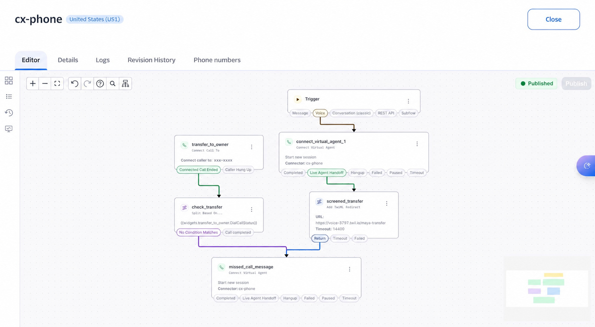
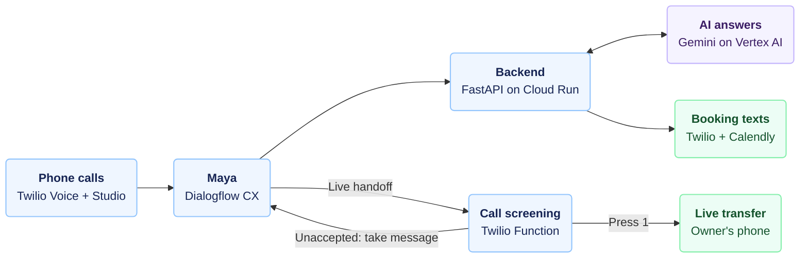

# Maya · Dialogflow CX Virtual Agent

A phone assistant for **Cloud Systems Direct**, built by Edward Thornton with Dialogflow CX, Gemini on Vertex AI, and FastAPI on Cloud Run. Maya captures caller details, answers service questions, and guides customers toward booking, a live transfer, or a message.

**Checkpoint: November 1, 2026.** The owner confirmed the press-1 transfer now works after correcting the destination number. The published Studio flow routes unaccepted transfers back to Maya for message capture; decline/no-answer checks and end-to-end message delivery remain to be verified.

## Phone flow

<a href="docs/images/cx-phone.jpg"></a>

*Published Studio flow: incoming call → Maya → screened transfer. The owner answers and presses 1 before connection; the Return path leads to Maya’s message-taking session. The older transfer/status widgets remain visible but are outside the active handoff route. Click to enlarge.*

## Current status

| Area | Status |
| --- | --- |
| Phone intake | Branded greeting, caller name, and callback confirmation exercised on calls. |
| Conversation | Contextual discovery, corrections, and service answers implemented and evaluated. |
| Booking and alerts | Booking-link and owner-alert texts received. Customers schedule in Calendly. |
| Live transfer | Owner confirmed the press-1 transfer works after correcting the destination number. |
| Missed-call messages | Studio Return is connected to Maya; unanswered return was previously observed. Decline/no-answer screening checks and full message delivery remain unverified. |

## Architecture



Twilio connects calls to Maya. The backend supports AI answers and booking texts. Studio invokes a protected Twilio Function for press-1 screening and resumes the message-taking widget when the function returns an unaccepted transfer.

| Component | Responsibility |
| --- | --- |
| Twilio Voice + Studio + Functions | Connect calls to Dialogflow, screen live handoffs with press-1 acceptance, and return unaccepted transfers to Maya. |
| Dialogflow CX | Manage intents, contact intake, conversation state, and action routes. |
| FastAPI on Cloud Run | Authenticate fulfillment requests and coordinate discovery and customer actions. |
| Gemini on Vertex AI | Use recent conversation context for extraction, answers, corrections, and summaries. |
| Twilio Messaging + Calendly | Send permission-based booking links and owner alerts; customers choose a meeting time externally. |

Security, design decisions, and failure handling are covered in the [architecture notes](docs/architecture.md).

## Development timeline

| Date | Milestone |
| --- | --- |
| Oct 25, 2026 | Built consultation intake, required form capture, a welcome response, and the external booking-link ending. |
| Oct 26 | Added FastAPI, structured Gemini discovery, Docker packaging, and local service checks. |
| Oct 27 | Deployed authenticated Cloud Run fulfillment and connected the Dialogflow agent to Twilio voice. |
| Oct 28 | Added caller contact intake, shorter prompts, booking texts, lead alerts, and message/handoff handlers. |
| Oct 29 | Added conversation history, correction handling, reviewed policy answers, and model evaluation. Approved Maya’s new greeting. |
| Oct 30 | Confirmed a working cell transfer and added the transfer-status split in Studio. |
| Oct 31–Nov 1 | Added protected call screening, published the Return route to Maya, corrected the owner destination, and confirmed the press-1 transfer works. |

## Validation

- **54 offline tests** passed at the last full run, with model responses and notifications mocked.
- **13 real Vertex requests** completed with zero errors and **1.20–5.32 seconds per generation** in one evaluation. Follow-up fixes constrained unsupported policy answers; these timings do not measure full calls.
- **Phone checks:** owner-confirmed press-1 transfer, previously observed unanswered return to Maya, and received booking/handoff texts. The new screening route still needs decline/no-answer checks and a complete message-delivery test.

Run the offline checks from the repository root:

```bash
python -m pip install -r requirements.txt -r requirements-dev.txt
python -m pytest -q
```

The real-model evaluator is `scripts/evaluate_conversation.py`. Deployment context and operational instructions are in the [current checkpoint](docs/project-notes.md).

## Repository guide

- [`backend/`](backend/) — FastAPI fulfillment, conversational discovery, contact handling, and notifications.
- [`dialogflow/agent/`](dialogflow/agent/) — versioned Dialogflow configuration.
- [`scripts/`](scripts/) and [`tests/`](tests/) — build/apply helpers, model evaluation, and offline checks.
- [`twilio/functions/maya-transfer.js`](twilio/functions/maya-transfer.js) — deployed screening function source; [setup and validation](docs/project-notes.md#screened-transfer-setup).
- [Portfolio page source](docs/dialogflow-cx.html) · [Current checkpoint](docs/project-notes.md) · [Detailed build history](docs/build-history.md).

## Next milestones

1. Verify ignored, declined, and failed calls through the new screening route, then check caller context and message delivery.
2. Export the completed Studio JSON flow for reproducible setup.
3. Verify email alerts and add dedicated database persistence for leads.
4. Continue real-call testing of recognition, corrections, interruptions, and the selected voice.

Message transcripts currently use Cloud Logging. Audio recording and in-call appointment creation are not implemented.

